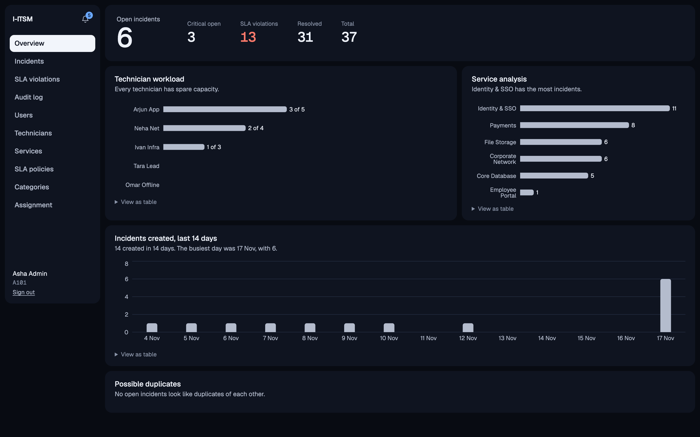

# I-ITSM: Intelligent IT Service Management & Incident Resolution System

CS F213 / MAC F212 Object-Oriented Programming project, Semester I 2026–27, BITS Pilani Hyderabad.

Employees report IT problems. The system classifies each incident, calculates its priority,
applies an SLA and picks a technician. It then notifies people, watches the SLA clock,
escalates incidents nobody acknowledges, and records every step in an append-only audit trail.
Administrators configure services, categories, SLA policies and the assignment strategy at
runtime, and see reports on incidents, workload and SLA violations.



## Features

| Area | What it does |
|---|---|
| Roles | Employee, Technician, Administrator, each with its own screens. Team lead, system admin and IT manager form the escalation chain |
| Lifecycle | NEW → CLASSIFIED → ASSIGNED → ACKNOWLEDGED → IN_PROGRESS ⇄ AWAITING_INFO → RESOLVED → VERIFIED → CLOSED, plus REOPENED. Illegal moves are refused (409) and audited |
| Priority | ITIL impact × urgency matrix, raised for business-critical services and many affected users. Staff can override it with a reason |
| Assignment | Skill-based, load-based and round-robin strategies, switchable at runtime |
| SLA | Response and resolution deadlines per priority. Warnings before the deadline, breaches recorded once, clock paused while waiting for the reporter |
| Notifications | In-app (live over Server-Sent Events) and email (simulated, or real SMTP through an adapter) |
| Intelligence | Duplicate detection and clusters (MiniLM embeddings), auto-categorization of "Not sure" reports, suggested resolutions from similar past incidents, automatic escalation, SLA risk warnings |
| Search & reports | 8 filters (id, status, priority, category, service, technician, SLA status, date range); overview, technician workload, incidents per service, duplicate clusters |
| Security | JWT, Argon2id password hashing, role checks, an ownership check on every incident (404 for outsiders), validated input |

## Architecture

```
React + Vite (role-based UIs)
        │  REST/JSON + JWT, SSE for live notifications
FastAPI routes (thin)  ──►  Application services (one transaction per use case)
                                   │
                         Domain layer (pure Python, no framework imports)
                         State · Strategy · Factory · Observer (EventBus)
                                   │ events published after commit
            ┌──────────────────────┼─────────────────────────┐
     Audit journal         Notifications             Intelligence + jobs
     (append-only)         (in-app, email)           (APScheduler: SLA monitor,
                                                      escalation, auto-close)
                                   │
                    Repositories / Unit of Work (SQLAlchemy 2) ──► PostgreSQL
```

Design patterns: **State** (incident lifecycle), **Strategy** (priority, assignment),
**Observer** (domain event bus), **Factory** (incidents, notification channels),
**Repository** and **Unit of Work** (persistence), **Adapter** (SMTP email), **Null Object**
(categorizer when no model is loaded). More detail: [`PROJECT.md`](PROJECT.md) and
[`docs/p2-backend.md`](docs/p2-backend.md).

## Tech stack

Python 3.11 · FastAPI · Pydantic · SQLAlchemy 2 + Alembic · PostgreSQL 16 (SQLite for local
runs and tests) · APScheduler · sentence-transformers (all-MiniLM-L6-v2) + scikit-learn ·
PyJWT + Argon2 · React + TypeScript + Vite + Tailwind + TanStack Query · pytest · ruff + mypy ·
Docker + GitHub Actions.

## Run it

### With Docker

```bash
cp .env.example .env          # set JWT_SECRET (32+ chars) and POSTGRES_PASSWORD
docker compose up --build     # API on http://localhost:8000, Postgres on :5432
docker compose exec app python -m scripts.seed
```

### Locally

```bash
pip install -e ".[dev]"            # add ".[dev,ml]" for the MiniLM model
make data                          # synthetic training data
python -m scripts.train_categorizer   # add --backend hashing without the ml extra
python -m scripts.seed             # demo data
uvicorn app.main:app --port 8000   # API docs: http://localhost:8000/api/docs

cd frontend && npm install && npm run dev   # http://localhost:5173
```

Without the `ml` extra, set `EMBEDDER_BACKEND=hashing` in `.env`. The frontend talks to the
real API by default; see [`frontend/README.md`](frontend/README.md) for the offline mock.

### Demo accounts

All seeded accounts use the password `demo1234` (or `SEED_PASSWORD` if set).

| Email | Role |
|---|---|
| `emp1@itsm.local`, `emp2@itsm.local` | Employee |
| `tech.app@itsm.local`, `tech.net@itsm.local`, `tech.infra@itsm.local` | Technician |
| `tech.off@itsm.local` | Technician, marked unavailable |
| `lead@itsm.local` | Technician, team lead (escalation level 1) |
| `sysadmin@itsm.local`, `manager@itsm.local` | Admin, escalation levels 2 and 3 |
| `admin@itsm.local` | Administrator |

Background jobs run on a schedule. To run one immediately, call
`POST /api/admin/jobs/{sla_monitor|escalation|auto_close}/run` as an admin from the API docs.

## Tests

```bash
pytest                         # unit + API tests on SQLite
pytest -m integration          # Postgres (needs DATABASE_URL)
pytest -m model                # real MiniLM model
make cases                     # writes the test-case catalogue to docs/testing/cases.md
```

Tests freeze time with a fake clock, so SLA and escalation behaviour is deterministic.
Measured results for the intelligent features, on synthetic data:
[duplicate detection](docs/metrics/duplicates.md).

## Repository layout

```
domain/         entities, lifecycle states, strategies, SLA, events, exceptions (no framework code)
app/services/   use cases: report, act, assign, admin
app/api/        FastAPI routes and auth dependencies
app/persistence/ repositories, unit of work, audit journal
app/intelligence/ embeddings, duplicates, categorizer, suggested resolutions
app/jobs/       SLA monitor, escalation, auto-close
notifications/  channels, rules, SSE broker, email adapter
frontend/       React app
scripts/        synthetic data, training, evaluation, seeding
tests/          unit, API, contract and job tests
```

## Team

<!-- Add each member's name next to their area before submitting. -->

| Area | Owns |
|---|---|
| Domain & OOP core | Domain classes, lifecycle, priority and assignment strategies, SLA clock, event bus |
| Backend, persistence, security | API, auth and ownership checks, database, repositories, search and reports |
| Frontend & notifications | Role UIs, dashboard, live notifications, email adapter |
| Intelligence, jobs, DevOps | Intelligent features, background jobs, Docker, CI, test catalogue |
